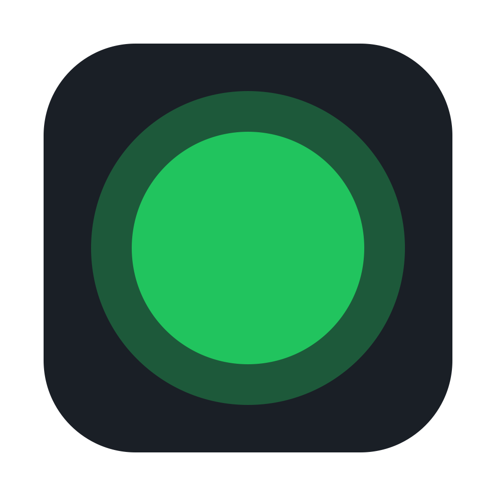

<p align="center">
  
</p>

<h1 align="center">CapsAwake</h1>

<p align="center">
  <strong>macOS · keep awake · even with the lid closed</strong>
</p>

<p align="center">
  <b>Caps Lock ON</b> — Mac stays awake<br>
  <b>Caps Lock OFF</b> — normal sleep
</p>

---

- **Green dot** — awake (lid, display, and idle sleep disabled)
- **Grey dot** — normal sleep
- **Red dot** — paused (battery ≤ 15% unplugged, critical thermal, or helper needs approval)

## Install / Uninstall

```sh
./scripts/install.sh
./scripts/uninstall.sh
```

[MIT](LICENSE)
